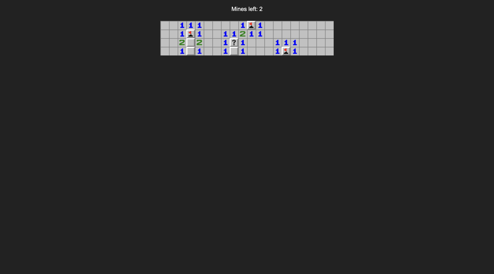

# Сапёр на JavaScript

Классический Сапёр в браузере. Чистые HTML, CSS и JavaScript: без фреймворков и библиотек.

**[Играть](https://1artard.github.io/simple-minesweeper-js/)**




## Как играть

- **Левая кнопка мыши** открывает клетку.
- **Правая кнопка мыши** ставит флажок, второе нажатие меняет его на вопросительный знак, третье снимает пометку.
- Число в клетке показывает, сколько мин среди восьми соседних клеток.
- **Победа:** открыты все клетки без мин. **Поражение:** открыта клетка с миной.
- Счётчик `Mines left` равен разности числа мин и числа поставленных флажков.
- После конца игры появляется ссылка для новой партии.

## Запуск

Достаточно просто скачать репозиторий и открыть `index.html` в браузере.

Размер поля и число мин меняются в начале `script.js`:

```js
let rows = 4
let columns = 20
let maxMines = 5   // должно быть меньше, чем rows * columns
```

## Что реализовано

- Поле строится динамически через `document.createElement`, размеры берутся из переменных.
- Мины расставляются **после первого клика**, поэтому первая открытая клетка никогда не мина.
- Для каждой клетки считается число соседних мин.
- Пустые области открываются рекурсивно.
- Закрытая клетка имеет три состояния: обычная, флажок, вопрос.
- При поражении показываются все мины и ошибочно поставленные флажки.
- Контекстное меню браузера отключено, чтобы работала правая кнопка.

## Структура проекта

```
.
├── index.html     разметка страницы
├── style.css      стили (поле на CSS Grid)
├── script.js      вся логика игры
└── img/           картинки клеток (hidden, flag, question, mine, misplaced, 0-8)
```

## Ограничения и идеи для развития

- Игра рассчитана на мышь: на телефоне нельзя поставить флажок.
- Безопасна только клетка первого клика, а не вся её окрестность, как в классической версии.
- Нет таймера и выбора сложности.
- Новая партия запускается перезагрузкой страницы.
- Флагов можно поставить больше чем мин. Счётчик уходит в минус.

Что можно добавить: таймер, уровни сложности, открытие соседей по клику на число, поддержку касаний (долгое нажатие вместо правой кнопки), исправить подсчет флажков.

## Чему я научился

До этого проекта я почти не писал на JavaScript. Большая часть была интуитивно понятна: язык похож на C++ и Python, с которыми я работаю. Некоторые вещи приходилось гуглить.

### Рекурсия

До проекта я понимал её только в теории, на практике не использовал. Сапёр показал, как она работает на деле. Открытие пустых клеток сделано рекурсивно: если открытая клетка пустая (рядом нет мин), функция `reveal` вызывает саму себя для всех её закрытых соседей. Соседи с числами просто открываются, и на них цепочка обрывается. Бесконечного вызова не происходит, потому что каждая клетка сразу помечается открытой, а вызов делается только для закрытых. Выход за границы поля отсекает функция `isInside`.

### Номера клеток

Долго думал, как и где хранить координаты клеток. Понял, что можно дать каждой клетке числовой `id` и хранить его прямо в HTML-элементе: при клике координаты вычисляются из `id` (строка — целая часть от деления на число столбцов, столбец — остаток). Тот же приём использовал при расстановке мин: выбирал случайный индекс, вычислял из него строку и столбец, проверял, что там нет мины и что это не клетка первого клика, и только потом ставил мину.

### Разделение на 3 массива

Думал, как работать с полем, и пришёл к трём массивам: `boardData` хранит мины и числа (0-8), `picture` хранит состояние клетки для игрока (закрыта, флажок, вопрос или открытое число), `tiles` хранит сами HTML-элементы. Когда каждый вид данных лежит отдельно, с ними легко работать. Альтернатива: один массив объектов вида «мина, число, состояние, элемент» для каждой клетки. Возможно, так было бы проще, потому что не пришлось бы следить за тремя массивами сразу.

### Мелочь: целочисленное деление

В JS нет оператора целочисленного деления, поэтому дробную часть я отбрасывал побитовым ИЛИ: `let r = (index / columns) | 0`. Побитовые операции приводят число к 32-битному целому. Альтернатива: `Math.floor` который проще читается в коде.

## Технологии

HTML5, CSS (Grid), JavaScript (ES6), DOM API.

## Благодарности

Спрайты взяты с [The Spriters Resource](https://www.spriters-resource.com/pc_computer/minesweeper/asset/19849/).